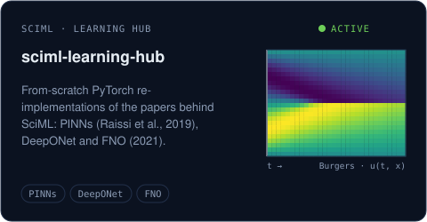
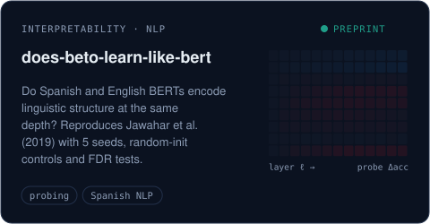
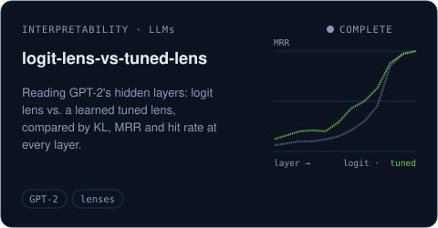

<!-- Profile README for github.com/jakomycat — search for "TODO" before publishing. -->

  

  I build neural PDE solvers, <b>physics-informed neural networks</b> and <b>neural operators</b>, and study when they work and where they break.

### About

<table>
  <tr><td><b>Studying</b></td><td>B.Sc. Computer Science, Universidad Nacional de Colombia, Manizales (graduating 2027)</td></tr>
  <tr><td><b>Main focus</b></td><td>Scientific ML: PINNs, neural operators (FNO, DeepONet), numerical PDEs</td></tr>
  <tr><td><b>Also</b></td><td>Interpretability of language models</td></tr>
  <tr><td><b>Now</b></td><td>Systematic study of padding and boundary conditions in Fourier Neural Operators</td></tr>
  <tr><td><b>Teaching</b></td><td>Teaching assistant, <i>Intro to Computer Science</i> and <i>Machine Learning</i> (2024-2 to 2026-1)</td></tr>
  <tr><td><b>Open to</b></td><td>Research internships in SciML / scientific computing, summer 2027 <!-- TODO: adjust or remove --></td></tr>
  <tr><td><b>Contact</b></td><td><!-- TODO: institutional email · ORCID · Google Scholar · CV --></td></tr>
</table>

### Scientific ML

  
  <!-- TODO: wrap the next image in <a href="..."> when the FNO repo is public -->
  

**Re-implemented from scratch** in [`sciml-learning-hub`](https://github.com/jakomycat/sciml-learning-hub):

| Paper | Year | What's there |
|:--|:--:|:--|
| Raissi, Perdikaris & Karniadakis, *Physics-informed neural networks* | 2019 | [data-driven solutions and discovery of PDEs](https://github.com/jakomycat/sciml-learning-hub/tree/main/papers/2019_raissi_pinns) |
| Lu et al., *DeepONet* | 2021 | [operator learning as a PDE solver](https://github.com/jakomycat/sciml-learning-hub/tree/main/papers/2021_lu_deeponet) |
| Li et al., *Fourier Neural Operator* | 2021 | [architecture](https://github.com/jakomycat/sciml-learning-hub/tree/main/papers/2021_li_fno) · experiments in progress |

**Next up:** <!-- TODO: keep only what you're comfortable making public -->

| Idea | Stage |
|:--|:--|
| Can a neural operator trained only on **low-fidelity solver data** beat the solver it learned from? | exploring |
| **μP for PINNs**: transfer learning-rate and loss weights when scaling width | exploring |
| Neural operators across **Reynolds numbers** in 2D Navier–Stokes: a spectral diagnosis of why they fail | thesis candidate |

### Interpretability

  
  

### Toolbox

`Python` `PyTorch` `NumPy` `Hugging Face Transformers` `Jupyter` `LaTeX` `Git`
<!-- TODO: add/remove to match what you actually use -->

The header and the learning-hub card show a real numerical solution of Burgers' equation (ν = 0.01/π), the PINN benchmark from Raissi et al.

